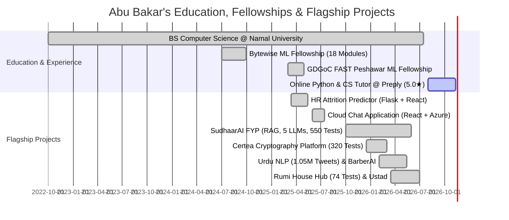

<h1 align="center">
    
</h1>

<h3 align="center">AI/ML & Full-Stack Software Engineer | BSCS Graduate | Karachi, Pakistan</h3>

<div align="center">
  
  [](https://git.io/streak-stats)
  
  
</div>

<div align="center">
  
</div>

## 🔍 About Me

```python
class SoftwareAndAIEngineer:
    def __init__(self):
        self.name = "Abu Bakar"
        self.role = "AI/ML & Full-Stack Software Engineer"
        self.education = "BS Computer Science @ Namal University Mianwali (Oct 2022 - July 2026)"
        self.location = "Karachi, Pakistan"
        self.languages_spoken = ["en_US", "ur_PK"]
        self.current_focus = [
            "RAG & Multi-Provider LLM Systems",
            "Full-Stack Web Engineering (Next.js / React / FastAPI / Flask / MERN)",
            "Applied NLP & Classical/Deep Learning Pipelines",
            "Cryptographic Backend Systems & Automated QA"
        ]
        self.experience = [
            # GenAI, RAG & LLM Engineering
            "RAG Pipelines", "ChromaDB Vector Search",
            "Multi-Provider LLM Fallback (Groq, OpenAI, Anthropic, Ollama, HuggingFace, Gemini)",
            "AST Static & Sandboxed Runtime Code Evaluation", "CodeBERT Semantic Gates",

            # Machine Learning & NLP
            "Urdu Sentiment & Emotion Classification",
            "Transformers (mBERT, XLM-RoBERTa)", "BiLSTM", "Linear SVM & Scikit-Learn",
            "Neural Networks from Scratch (NumPy)", "GridSearchCV & Imbalanced Learning",

            # Full-Stack & Backend Engineering
            "Next.js", "React", "TypeScript", "Node.js & Express",
            "Python (Flask, FastAPI)", "MySQL", "MongoDB",
            "Upstash Redis Rate Limiting", "Pydantic & Zod Schema Validation",

            # Security, Cryptography & Cloud DevOps
            "RSA 2048-Bit Digital Signatures", "AES-256 Encrypted Storage",
            "X.509-Style Certificate Workflows", "JWT & Multi-Layer RBAC",
            "Docker Compose", "GitHub Actions CI/CD", "Azure & Vercel"
        ]

    def say_hi(self):
        print("Thanks for dropping by! Let's build tested, production-ready intelligent systems together.")

me = SoftwareAndAIEngineer()
me.say_hi()
```

## 🔭 What I Build & Recent Highlights

- **Final Year Project ([SudhaarAI](https://github.com/abubakarp789/SudhaarAI))**
  - Co-built a full-stack AI code learning and refactoring platform combining **Next.js (React, TypeScript)** and **30+ Flask REST API routes** with a **RAG pipeline** over **7,000+ ChromaDB documents**, **5-provider LLM fallback** (`Groq`, `OpenAI`, `Anthropic`, `Ollama`, `HuggingFace`), an **18-feature quality scorer** (`8` AST static + `5` sandboxed runtime + `5` best-practice rules) with a **0.95 CodeBERT similarity gate**, **4-service Docker Compose** deployment on **Azure**, and **550+ automated tests**.

- **Large-Scale Urdu NLP & Applied Machine Learning ([Urdu NLP](https://github.com/abubakarp789/Robust-Sentiment-and-Emotion-Classification-on-Noisy-Urdu-Tweets) & [HR Attrition Predictor](https://github.com/abubakarp789/HR-Attrition-Predictor))**
  - Co-developed a **1.05M-tweet Urdu corpus pipeline** benchmarking **8 model families** (`Linear SVM` achieving `0.5040` sentiment and `0.2854` emotion Macro-F1 alongside `BiLSTM`, `mBERT`, and `XLM-RoBERTa`).
  - Engineered a **5-fold GridSearchCV-tuned Decision Tree** (`97.97%` accuracy, `0.9566` minority-class F1, `0.9717` Macro-F1 on `14,999` HR records) served via a containerized **7-endpoint Flask REST API + React 19 SPA**.

- **Cryptographic Backends & Full-Stack Web Apps ([Certea](https://github.com/abubakarp789/Certea), [Rumi House Hub](https://github.com/abubakarp789/Rumi-House-Hub), [Ustad](https://github.com/abubakarp789/ustad))**
  - Built **Certea** (`FastAPI` + `Next.js 14` digital signature platform with `RSA-2048`, `AES-256`, `X.509-style` certificates, and **320 pytest tests**), **Rumi House Hub** (`MERN` stack with `7` Mongoose schemas, `3`-layer JWT/RBAC authorization, and **74 tests**), and **Ustad** (`Next.js 16` + `PostgreSQL/Prisma 7` + `Gemini` cloud lab automation agent with `Zod` validation and `Upstash Redis` rate limiting).

- **CS & Python Mentorship ([Preply](https://preply.com/en/tutor/8318168))**
  - **5.0★ Online Python & Computer Science Tutor** on Preply (`30+` completed 1-on-1 lessons); formerly **Head of Skill Development Wing at NSSI Society** and **Beta Microsoft Learn Student Ambassador**.

## 🎓 Education, Fellowships & Leadership

<div align="center">
  
  
  
  
  
  
</div>

## 🏆 GitHub Trophies

<div align="center">
  
</div>

## 📊 GitHub Stats

<div align="center">
  
  
</div>

<div align="center">
  
</div>

## 🛠️ Tech Stack & Tools

<div align="center">
  <h3>🧠 AI, LLMs, ML & Data Science</h3>
  <p>
    
    
    
    
    
    
    
    
    
  </p>
  
  <h3>💻 Languages, Full-Stack & Databases</h3>
  <p>
    
    
    
    
    
    
    
    
    
    
    
    
    
    
    
    
  </p>
  
  <h3>🔧 DevOps, Testing & Cloud Platforms</h3>
  <p>
    
    
    
    
    
    
    
    
    
    
  </p>
</div>

## 📂 Featured Projects

<table>
  <tr>
    <td width="50%">
      <h3 align="center">SudhaarAI (FYP)</h3>
      <div align="center">
        <a href="https://github.com/abubakarp789/SudhaarAI" target="_blank">
          
        </a>
        <p>
          <a href="https://github.com/abubakarp789/SudhaarAI" target="_blank">
            
          </a>
          <a href="https://sudhaarai.me" target="_blank">
            
          </a>
        </p>
        <p><strong>Next.js 16, React 19, TypeScript, Flask, ChromaDB, Docker, Azure</strong> — Co-built AI code platform with 31 REST routes, a 9-stage RAG pipeline over 7,052 docs, 5-provider LLM fallback (Groq, OpenAI, Anthropic, Ollama, HuggingFace), an 18-feature AST/runtime quality scorer + 0.95 CodeBERT gate, and 550 automated tests.</p>
      </div>
    </td>
    <td width="50%">
      <h3 align="center">Certea</h3>
      <div align="center">
        <a href="https://github.com/abubakarp789/Certea" target="_blank">
          
        </a>
        <p>
          <a href="https://github.com/abubakarp789/Certea" target="_blank">
            
          </a>
        </p>
        <p><strong>FastAPI, Next.js 14, TypeScript, Cryptography, Pydantic, Pytest</strong> — Digital signature and certificate platform implementing RSA 2048-bit signing (PKCS#1 v1.5 & PSS), AES-256 encrypted key storage, X.509-style certificate workflows, a 404-line Pydantic validation module across 10 REST endpoints, and 320 automated pytest tests.</p>
      </div>
    </td>
  </tr>
  <tr>
    <td width="50%">
      <h3 align="center">Urdu Tweet Emotion & Sentiment Classifier</h3>
      <div align="center">
        <a href="https://github.com/abubakarp789/Robust-Sentiment-and-Emotion-Classification-on-Noisy-Urdu-Tweets" target="_blank">
          
        </a>
        <p>
          <a href="https://github.com/abubakarp789/Robust-Sentiment-and-Emotion-Classification-on-Noisy-Urdu-Tweets" target="_blank">
            
          </a>
        </p>
        <p><strong>Python, PyTorch, Transformers (mBERT, XLM-R), Scikit-Learn, NLP</strong> — Co-developed a 1.05M-tweet Urdu preprocessing and evaluation pipeline benchmarking 8 model families across 19 notebooks, achieving 0.5040 sentiment and 0.2854 emotion Macro-F1 with Linear SVM alongside BiLSTM, mBERT, and XLM-RoBERTa.</p>
      </div>
    </td>
    <td width="50%">
      <h3 align="center">Rumi House Hub</h3>
      <div align="center">
        <a href="https://github.com/abubakarp789/Rumi-House-Hub" target="_blank">
          
        </a>
        <p>
          <a href="https://github.com/abubakarp789/Rumi-House-Hub" target="_blank">
            
          </a>
        </p>
        <p><strong>React 18, Vite, Node.js, Express 5, MongoDB, Vitest, Pytest</strong> — Team-built MERN web application featuring 7 Mongoose schemas, 5 modular REST routes, and three-layer authorization (HS256-pinned JWT auth, role middleware, and object-level policy enforcement in <code>accessPolicies.js</code>) backed by 74 automated tests.</p>
      </div>
    </td>
  </tr>
  <tr>
    <td width="50%">
      <h3 align="center">Ustad — Cloud Lab AI Assistant</h3>
      <div align="center">
        <a href="https://github.com/abubakarp789/ustad" target="_blank">
          
        </a>
        <p>
          <a href="https://github.com/abubakarp789/ustad" target="_blank">
            
          </a>
          <a href="https://ustad-kappa.vercel.app" target="_blank">
            
          </a>
        </p>
        <p><strong>Next.js 16, TypeScript, PostgreSQL (Prisma 7), Redis, Google Gemini</strong> — AI workflow application translating cloud lab instructions into CLI automation scripts with Zod runtime schema validation, regex safety filters, Clerk auth, Upstash Redis sliding-window rate limiting, and 16 Vitest tests.</p>
      </div>
    </td>
    <td width="50%">
      <h3 align="center">HR Attrition Predictor</h3>
      <div align="center">
        <a href="https://github.com/abubakarp789/HR-Attrition-Predictor" target="_blank">
          
        </a>
        <p>
          <a href="https://github.com/abubakarp789/HR-Attrition-Predictor" target="_blank">
            
          </a>
        </p>
        <p><strong>Python, Flask, React 19, Scikit-Learn, Pandas, Docker</strong> — End-to-end employee turnover prediction system powered by a 5-fold GridSearchCV Decision Tree (97.97% accuracy, 0.9566 minority-class F1, 0.9717 Macro-F1 on 14,999 rows) served via a 7-endpoint Flask REST API and React 19 dashboard.</p>
      </div>
    </td>
  </tr>
  <tr>
    <td width="50%">
      <h3 align="center">BarberAI</h3>
      <div align="center">
        <a href="https://github.com/abubakarp789/BarberAI" target="_blank">
          
        </a>
        <p>
          <a href="https://github.com/abubakarp789/BarberAI" target="_blank">
            
          </a>
          <a href="https://barberai-397948872922.us-central1.run.app/" target="_blank">
            
          </a>
        </p>
        <p><strong>React 19, TypeScript, Express, Firebase, Gemini Vision, Cloud Run</strong> — Built during the 3-day GDG AI Seekho Hackathon. Features multimodal face-shape analysis via server-side Gemini API proxying, booking workflows, default-deny Firestore security rules, and containerized Google Cloud Run deployment.</p>
      </div>
    </td>
    <td width="50%">
      <h3 align="center">Cloud Chat Application</h3>
      <div align="center">
        <a href="https://github.com/abubakarp789/Chat-Application-Project" target="_blank">
          
        </a>
        <p>
          <a href="https://github.com/abubakarp789/Chat-Application-Project" target="_blank">
            
          </a>
        </p>
        <p><strong>React 18, Node.js, Express, Firebase, Azure Blob Storage, Docker</strong> — Real-time messaging and file-sharing platform combining Firebase client auth, Express backend token verification, Firestore real-time listeners, and Azure Blob Storage media uploads.</p>
      </div>
    </td>
  </tr>
</table>

## 📅 Timeline of My Journey



## 📫 Connect With Me

<div align="center">
  <a href="https://abubakar056.netlify.app/" target="_blank">
    
  </a>
  <a href="mailto:abubakarp789@gmail.com">
    
  </a>
  <a href="https://www.linkedin.com/in/abubakar56" target="_blank">
    
  </a>
  <a href="https://www.kaggle.com/abubakarpanhwar" target="_blank">
    
  </a>
  <a href="https://huggingface.co/abubakar56" target="_blank">
    
  </a>
  <a href="https://preply.com/en/tutor/8318168" target="_blank">
    
  </a>
</div>

<h3 align="center">
    
</h3>

<a href="https://holopin.io/@abubakarp789" title="View my Holopin profile">
   
</a>
